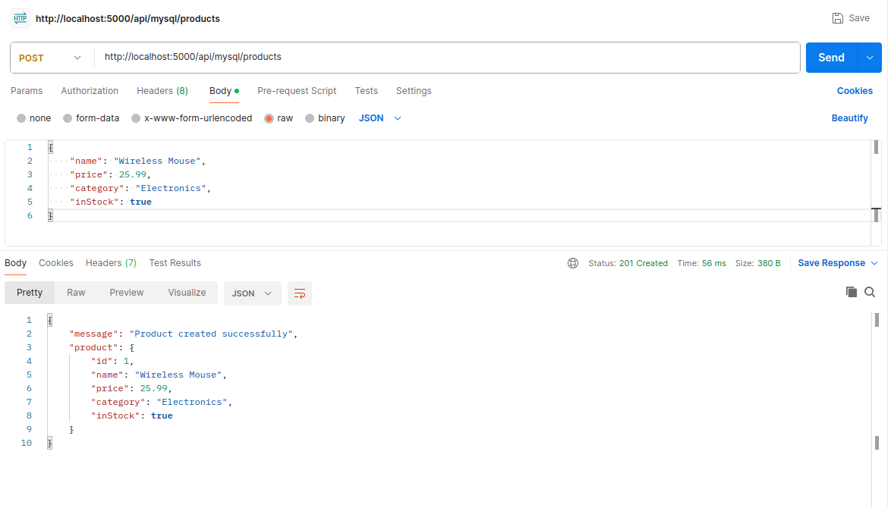
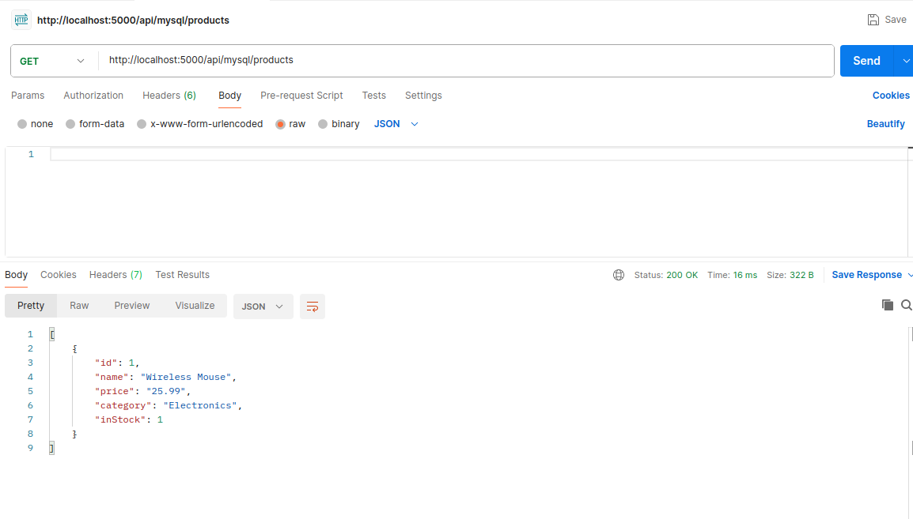
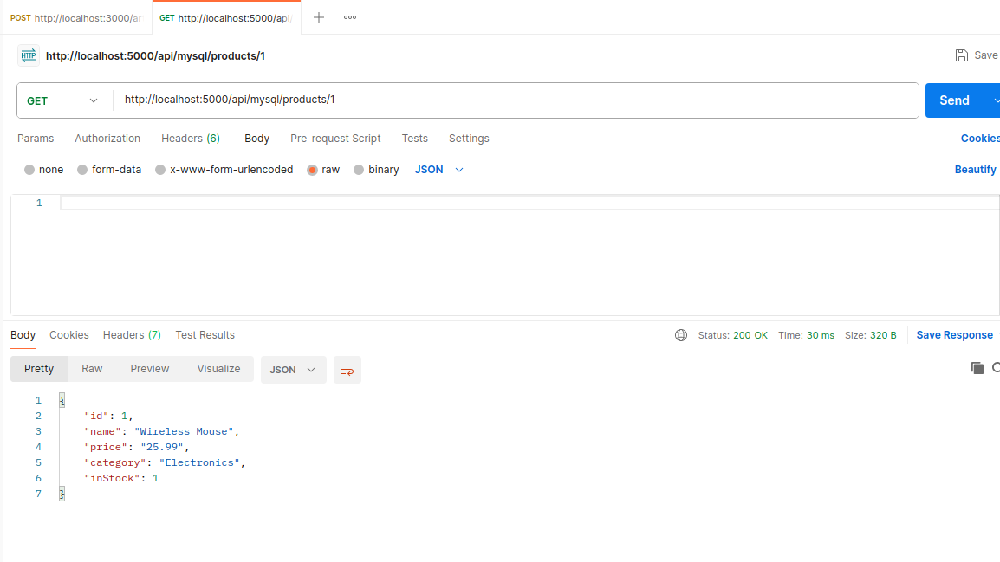
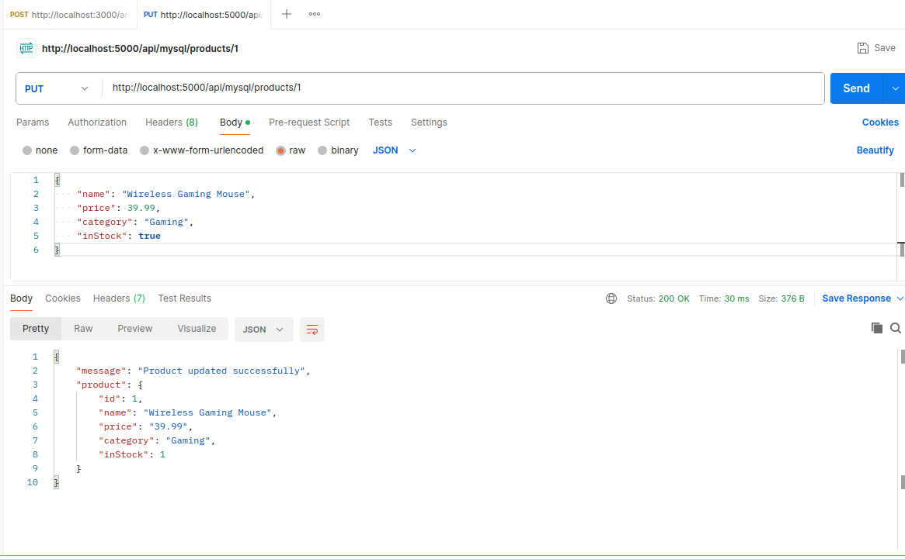
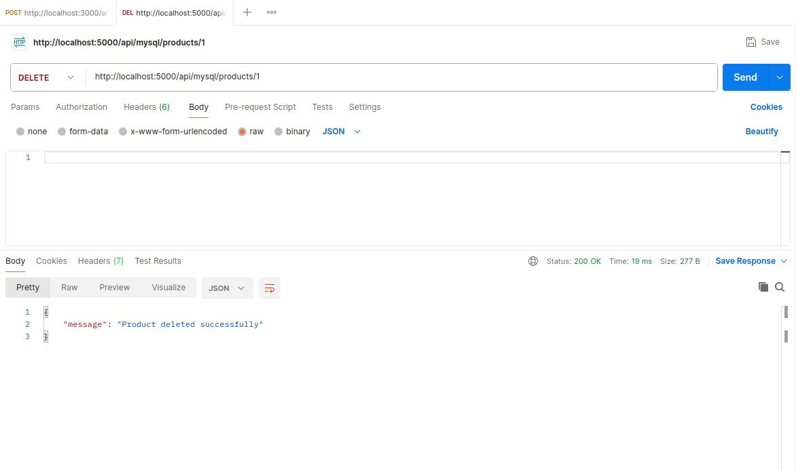
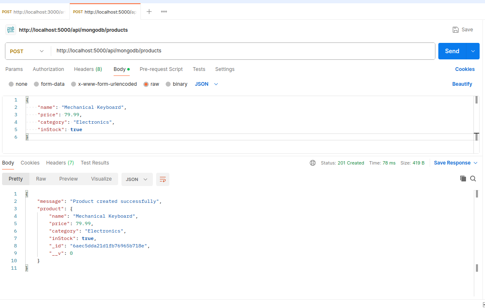
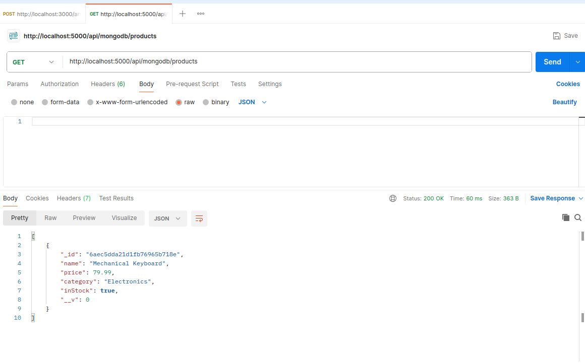
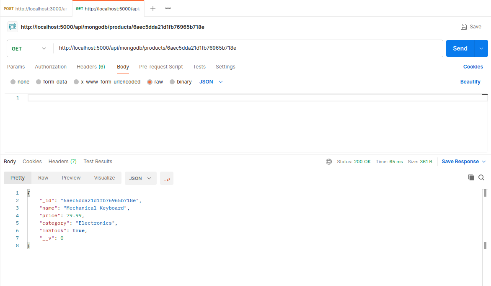
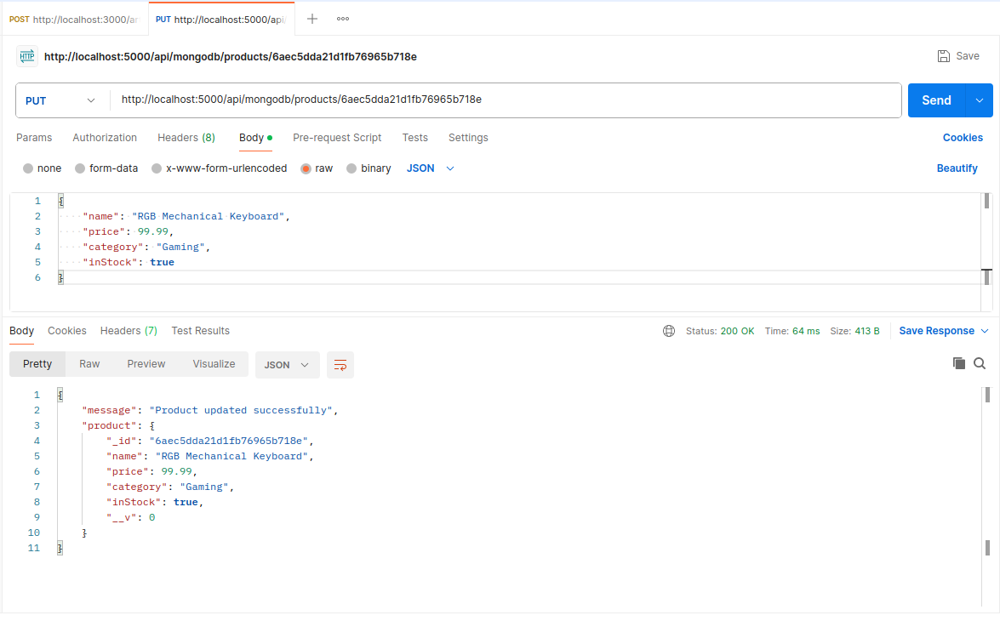
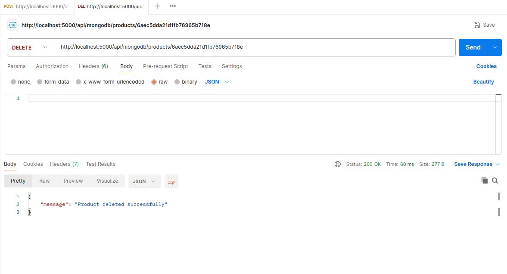

# Product CRUD Challenge: SQL & NoSQL Edition

A REST API built with Node.js and Express to perform CRUD (Create, Read, Update, Delete) operations on products using two databases: **MySQL (MariaDB)** and **MongoDB**.

The project demonstrates how the same operations can be implemented using a relational database and a NoSQL database.

### MySQL

Base URL: `/api/mysql/products`

| Method | Endpoint                  | Description         |
| ------ | ------------------------- | ------------------- |
| POST   | `/api/mysql/products`     | Create a product    |
| GET    | `/api/mysql/products`     | Get all products    |
| GET    | `/api/mysql/products/:id` | Get a product by ID |
| PUT    | `/api/mysql/products/:id` | Update a product    |
| DELETE | `/api/mysql/products/:id` | Delete a product    |

### MongoDB

Base URL: `/api/mongodb/products`

| Method | Endpoint                    | Description         |
| ------ | --------------------------- | ------------------- |
| POST   | `/api/mongodb/products`     | Create a product    |
| GET    | `/api/mongodb/products`     | Get all products    |
| GET    | `/api/mongodb/products/:id` | Get a product by ID |
| PUT    | `/api/mongodb/products/:id` | Update a product    |
| DELETE | `/api/mongodb/products/:id` | Delete a product    |

## Product Fields

Each product contains:

| Field    | Type           | Description                                |
| -------- | -------------- | ------------------------------------------ |
| id       | Auto-generated | Unique product identifier                  |
| name     | String         | Required product name                      |
| price    | Number         | Required product price                     |
| category | String         | Optional product category                  |
| inStock  | Boolean        | Indicates availability; defaults to `true` |

MongoDB automatically generates an `_id` for each document, while MySQL uses an auto-incrementing `id`.

## Testing

All CRUD operations were tested using **Postman**.

### MySQL Tests

**1. Create Product**

**2. Get All Products**

**3. Get Product by ID**

**4. Update Product**

**5. Delete Product**

### MongoDB Tests

**6. Create Product**

**7. Get All Products**

**8. Get Product by ID**

**9. Update Product**

**10. Delete Product**

